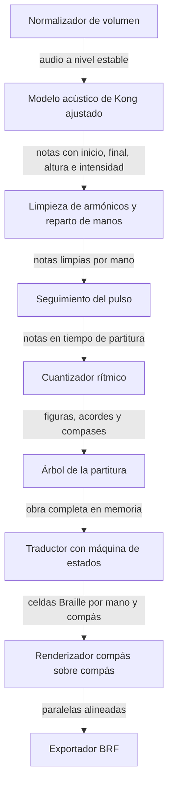

# Visión general del sistema

## Qué es

amt-braille-translator es un sistema de código abierto que recibe una grabación de piano y entrega la partitura de esa obra en musicografía Braille, en un archivo BRF listo para leerse en una línea Braille o imprimirse en una impresora Braille. Lo desarrollé como trabajo de graduación en la Universidad del Valle de Guatemala.

El sistema une dos mundos que hasta ahora estaban separados. Por un lado está la transcripción musical automática, que con redes neuronales convierte audio en notas. Por otro lado están los traductores a Braille musical, que necesitan una partitura digital como entrada. Nadie había conectado los dos de forma que una persona ciega pudiera partir de una grabación.

## Por qué escogí este tema

Una persona ciega que quiere estudiar piano depende de que alguien haya transcrito la obra a Braille. Ese trabajo lo hace un transcriptor especializado, tarda semanas y existe para muy pocas obras. La mayor parte del repertorio que un estudiante quiere tocar simplemente no está disponible en Braille.

Al mismo tiempo, casi cualquier obra está grabada y disponible. Me pareció que el tramo que faltaba, de la grabación a la partitura Braille, era un problema concreto que podía atacar con lo que sé de inteligencia artificial y de compiladores: un modelo para escuchar y un traductor determinista para escribir con las reglas del Manual de musicografía Braille. También me interesaba que el resultado se pudiera medir contra el trabajo de un transcriptor humano, porque en la literatura no encontré una métrica para eso.

## Cómo funciona en una página

El usuario abre la aplicación web desde su computadora o su teléfono, elige una grabación, indica el tempo aproximado, el compás y la armadura, y pulsa convertir. La aplicación sube el audio a la API, que lo procesa en segundo plano mientras la aplicación consulta el estado cada dos segundos. Cuando termina, el usuario descarga el BRF.

Por dentro, la API pasa el audio por una cadena de etapas. Primero lo normaliza en volumen. Después el modelo de Kong, ajustado por mí para grabaciones con ruido y reverberación, detecta cada nota con su inicio, su final, su altura y su intensidad. Luego una limpieza quita los armónicos que el modelo confunde con notas y reparte las notas entre mano derecha e izquierda. El seguimiento del pulso sigue los cambios de tempo del intérprete y el cuantizador convierte los tiempos en figuras y compases. Con eso se construye un árbol que representa la partitura completa, y el traductor lo recorre aplicando las reglas del Manual con ayuda de una máquina de estados que recuerda la última octava y las alteraciones vigentes. Al final el renderizador alinea las dos manos en formato compás sobre compás y el exportador escribe el BRF.

## Las etapas del pipeline

Cada etapa recibe la salida de la anterior y no sabe nada de las demás. Esa separación fue la que me permitió probar cada mejora por separado y medir cuánto aportaba.

## Qué entrega y qué no

El sistema escribe piano a dos manos con 28 reglas de nueve secciones del Manual simplificado de musicografía braille de Aller Pérez, más la agrupación de semicorcheas de la sección IV que agregué al ver que las referencias la usan siempre. No escribe ornamentos, matices, digitación ni pedal en su notación Braille, y no procesa voz cantada ni otros instrumentos.

Tampoco estima el tempo, el compás ni la armadura a partir del audio. Esos tres datos los pide al usuario, y el tempo solo como punto de partida, porque después el sistema sigue el pulso de la grabación.

## Cómo se ve para el usuario

La aplicación tiene tres modos que se eligen al entrar y se pueden cambiar en cualquier momento.

| Modo | Para quién | Qué cambia |
| --- | --- | --- |
| Tutor | Docentes y personas videntes que acompañan el estudio | Interfaz estándar con una vista previa del Braille generado |
| Baja visión | Personas con visibilidad reducida | Alto contraste, texto al menos 1.6 veces mayor y controles de 64 píxeles |
| Lector de pantalla | Personas ciegas que usan TalkBack, VoiceOver, NVDA u Orca | Alto contraste y una estructura lineal con encabezados y anuncios del estado |

La aplicación sugiere el modo según la configuración de accesibilidad del sistema operativo, por ejemplo si detecta un lector de pantalla activo.

## Dónde está cada cosa

| Carpeta | Contenido |
| --- | --- |
| `src/amt` | Audio, modelo acústico, limpieza, pulso y cuantizador |
| `src/braille_translator` | Árbol de la partitura, máquina de estados, traductor, renderizador y exportador |
| `src/evaluation` | Métrica BSA, desglose y lectura de referencias Braille |
| `src/api` | API REST con FastAPI |
| `src/pipeline.py` | Orquestación de todas las etapas |
| `cliente` | Aplicación web progresiva en Flutter y sus pruebas de accesibilidad |
| `notebooks` | Experimentos ejecutados en Kaggle con GPU |
| `scripts` | Mediciones locales que generan los datos de `results` |
| `results` | Datos y figuras de cada objetivo |
| `tests` | 249 pruebas unitarias |
