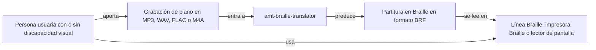
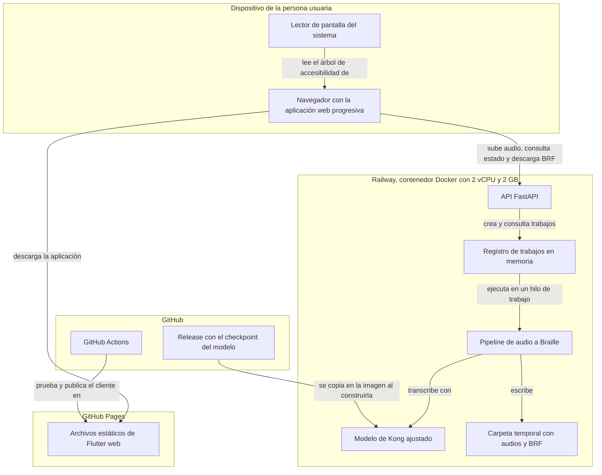
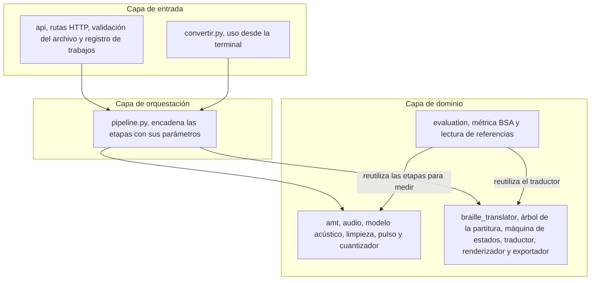
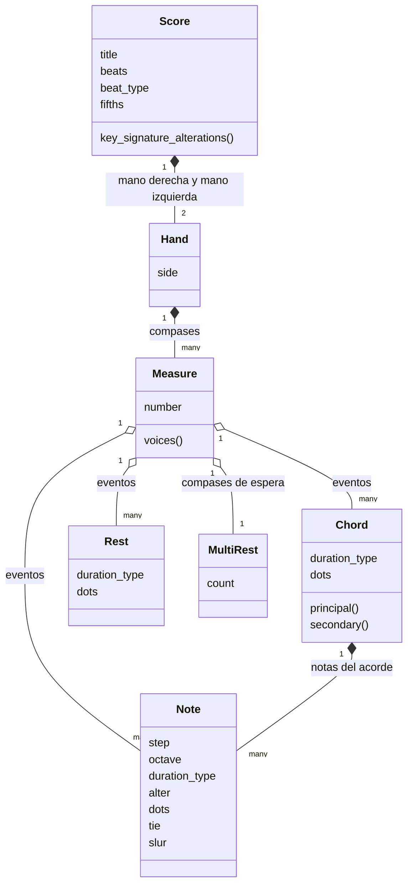
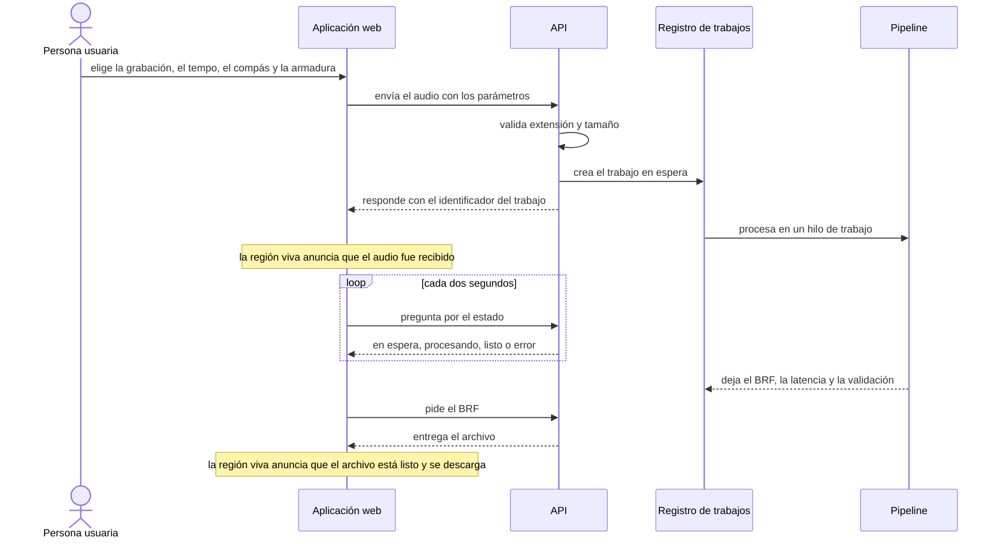
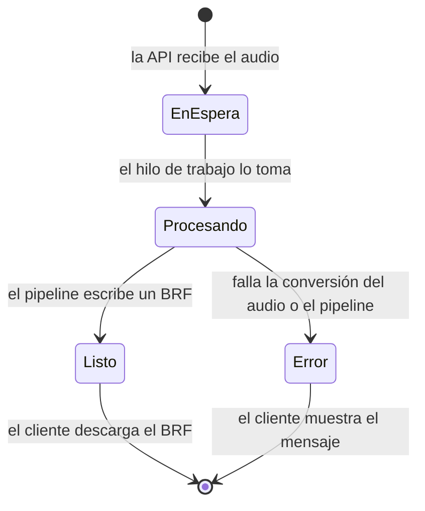
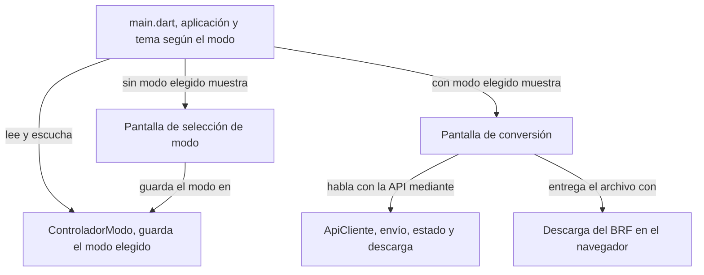
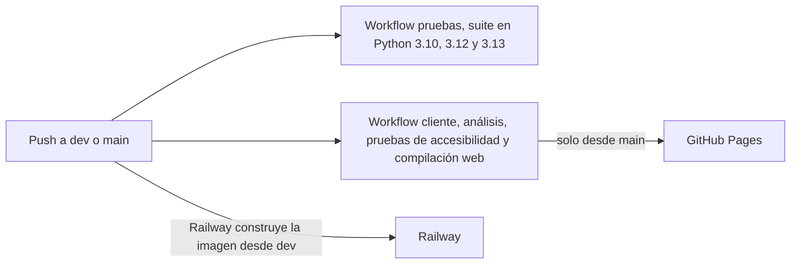

# Arquitectura

En este documento explico cómo está construido el sistema, qué estilo de arquitectura sigue, qué patrones de diseño usé y por qué. Lo escribí pensando en quien quiera modificarlo o desplegarlo.

## Resumen

El sistema es una aplicación cliente-servidor. El cliente es una aplicación web progresiva escrita en Flutter, que se publica como sitio estático. El servidor es una API REST escrita en Python con FastAPI, que envuelve un pipeline de procesamiento en forma de tuberías y filtros. Dentro del servidor el código está organizado como un monolito modular en capas, donde cada paquete de dominio tiene una responsabilidad y no conoce a los demás.

| Aspecto | Decisión |
| --- | --- |
| Estilo general | Cliente-servidor con frontend y backend desplegados por separado |
| Comunicación | HTTP con JSON, petición asíncrona con consulta periódica del estado |
| Backend | Monolito modular en capas |
| Procesamiento | Tuberías y filtros, una etapa por módulo |
| Estado de los trabajos | En memoria del proceso, sin base de datos |
| Ejecución del modelo | Una sola instancia por proceso, cargada la primera vez que se usa |
| Despliegue | Contenedor Docker para la API y sitio estático para el cliente |

## Vista de contexto

## Vista de contenedores y despliegue

El cliente y la API no comparten nada más que el contrato HTTP. Puedo cambiar el cliente sin tocar el servidor y al revés. El checkpoint del modelo, de 172 MB, se descarga del release de GitHub cuando se construye la imagen Docker, así que el contenedor arranca sin depender de internet para el modelo.

## Capas del backend

La regla que seguí es que las dependencias solo bajan. La API conoce al pipeline, el pipeline conoce a los paquetes de dominio, y los paquetes de dominio no saben que existe una API. Por eso el mismo pipeline sirve para la API, para la terminal y para las evaluaciones, y las pruebas de la API pueden reemplazar el modelo por uno falso sin cargar PyTorch.

El contrato entre la etapa acústica y la determinista es `TranscriptionResult`, definido en `src/amt/events.py`: una lista de notas con inicio, final, altura MIDI e intensidad, más los eventos de pedal y la duración del audio. Cualquier modelo acústico que entregue esa estructura puede reemplazar al de Kong.

## Patrones de diseño

| Patrón | Dónde | Para qué |
| --- | --- | --- |
| Tuberías y filtros | `pipeline.py` y las etapas de `amt` y `braille_translator` | Cada etapa transforma una estructura bien definida y se puede probar, medir o reemplazar sola |
| Fábrica con inyección de dependencias | `create_app(transcriber_factory)` en `src/api/app.py` | Las pruebas inyectan un transcriptor falso y la API real usa el modelo de Kong |
| Instancia única perezosa | `AMTTranscriber._load` y el contenedor del transcriptor en `create_app` | El modelo se carga una sola vez por proceso y solo cuando llega el primer audio |
| Máquina de estados finitos | `OctaveState` y `AccidentalState` en `fsm.py` | Recordar la octava de la nota anterior y las alteraciones vigentes en el compás, como exige el Manual |
| Árbol de sintaxis abstracta | `model.py` | Tener la obra completa en memoria antes de escribir, para alinear las dos manos compás por compás |
| Despacho por tipo de nodo | `HandTranslator` en `translator.py` | Recorrer el árbol y llamar a la función de cada tipo de evento, con el mismo efecto que el patrón Visitor y menos código |
| Estrategias como parámetros | `quantize(hands=..., voices=...)`, `evaluate_piece(pre=..., hands=...)` | Cambiar el reparto de manos o la limpieza sin tocar el cuantizador, que es como medí cada mejora |
| Productor y consumidor | `JobStore` en `src/api/jobs.py` | La API recibe el audio y responde de inmediato, y un hilo de trabajo lo procesa |

### Sobre el singleton

No hay una clase Singleton global. Lo que hay es una instancia única del modelo por aplicación. `create_app` guarda el transcriptor en un contenedor y lo crea la primera vez que llega un audio, y `AMTTranscriber` carga los pesos en su primer uso. Lo hice así porque cargar el modelo tarda unos segundos y ocupa cerca de 1 GB de memoria, y no tenía sentido repetirlo en cada conversión. Al no ser un singleton global, las pruebas pueden crear otra aplicación con otro transcriptor sin interferir.

## El árbol de la partitura

Las clases del árbol son solo datos. Toda la lógica de traducción está en el traductor, que consulta la máquina de estados mientras recorre los compases. Necesité el árbol completo porque el formato compás sobre compás exige que las barras de ambas manos queden alineadas en vertical, y para saber cuánto relleno poner en una mano hay que conocer de antemano cuánto mide el mismo compás en la otra.

## Flujo de una conversión

Elegí este esquema de petición asíncrona con consulta periódica porque una conversión puede tardar varios minutos en CPU. Una petición que esperara todo ese tiempo se cortaría en muchos proxies, y el usuario no tendría cómo saber en qué va el proceso.

## Ciclo de vida de un trabajo

En el código los estados se llaman `queued`, `processing`, `done` y `error`. Cada trabajo guarda además la duración del audio, la latencia, el cociente entre ambas, si el audio está dentro del alcance de cinco minutos y si el BRF pasó la validación.

## Cliente

El cliente está escrito en Flutter y se compila a web. Lo publiqué como aplicación web progresiva para que se pueda instalar desde el navegador en una computadora o en un teléfono, sin tiendas de aplicaciones.

La accesibilidad está en la estructura de la interfaz y no es una capa aparte. Cada control tiene una etiqueta semántica, la pantalla de conversión es la región principal, las secciones son encabezados numerados y el estado del trabajo es una región viva que el lector de pantalla anuncia sin mover el foco.

## Integración y entrega continuas

Cada cambio corre las 249 pruebas de Python y las pruebas de accesibilidad del cliente. GitHub Pages publica el cliente desde `main`. Railway construye la imagen de la API cada vez que cambian `src`, `requirements.txt` o el `Dockerfile` en `dev`; en [Operación, seguridad y KPIs](08_operacion_seguridad_y_kpis.md) recomiendo moverlo a `main`.
