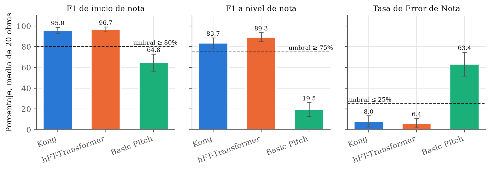
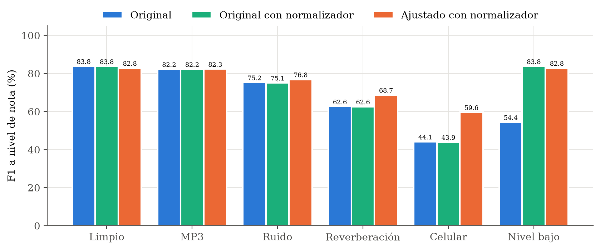
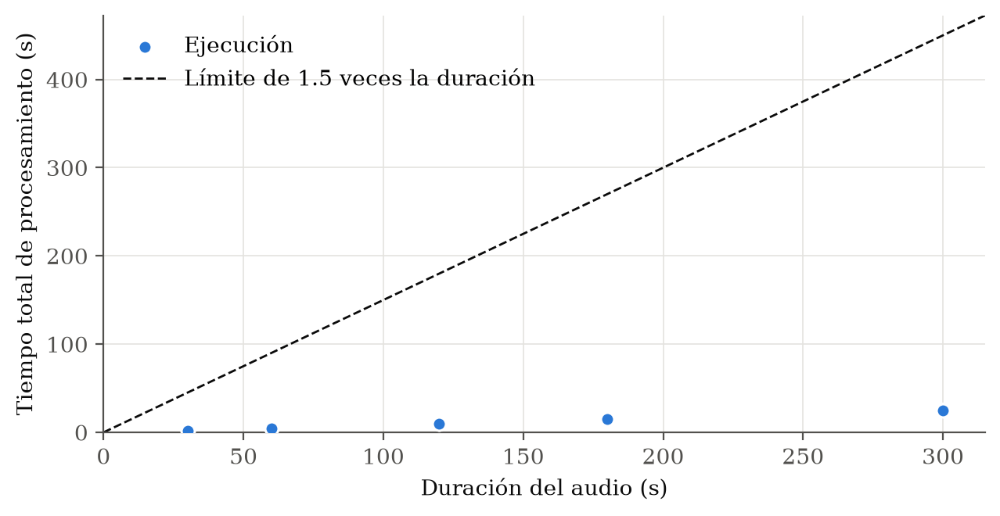
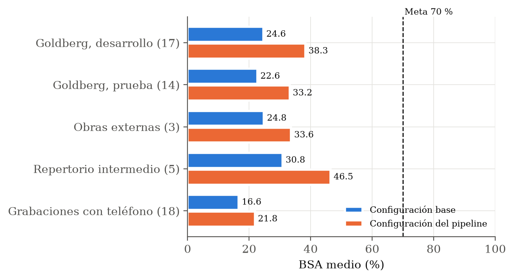
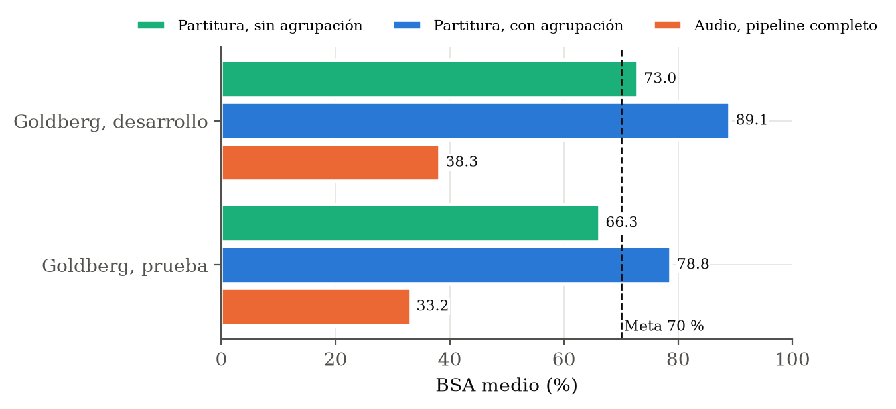
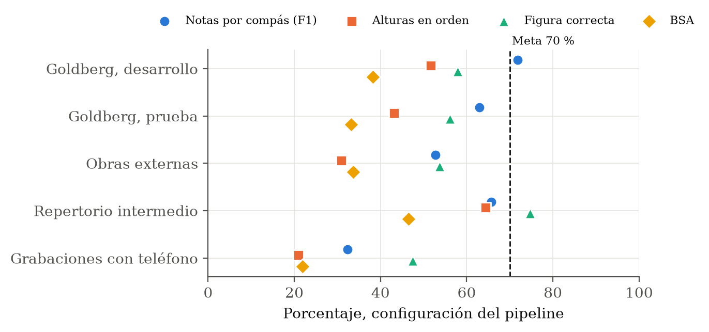
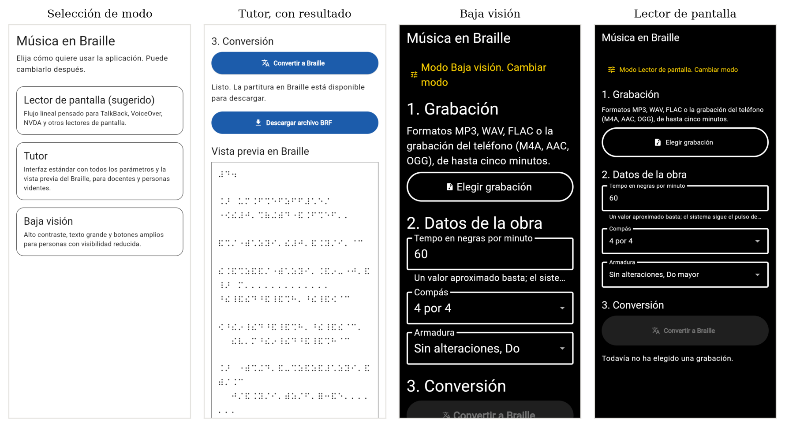

# Resultados

Aquí resumo lo que medí en cada objetivo y los valores que obtuve. El detalle pieza por pieza, con todas las tablas, está en el capítulo de Resultados de la tesis, y los datos están en `results/`.

## Cumplimiento por objetivo

| Objetivo | Criterio | Lo que obtuve | Estado |
| --- | --- | --- | --- |
| 1. Seleccionar el modelo acústico | F1 de inicio de nota de 80 % o más, F1 de nota de 75 % o más, error de 25 % o menos | Kong obtuvo 95.89 %, 83.74 % y 8.01 % sobre 20 obras de MAESTRO | Cumplido |
| 2. Ajustar el modelo a condiciones de uso | Mejora de 5 puntos o más fuera de estudio sin perder más de 2 en audio limpio | Mejora de 5.79 puntos y pérdida de 1.00 punto | Cumplido con audio de estudio, no con grabaciones de teléfono |
| 3. Módulo determinista de traducción | 28 reglas trazadas y probadas | 28 de 28 reglas, 249 pruebas | Cumplido |
| 4. Sistema integrado | Cociente de tiempo de 1.5 o menos con BRF válido en 90 % o más de las ejecuciones | 100 % en GPU, CPU local y Railway; peor caso 1.21 con 2 núcleos | Cumplido |
| 5. Fidelidad frente a la referencia humana | Exactitud de Símbolo Braille de 70 % o más | 33.2 % en la prueba de Goldberg y 46.5 % en el repertorio intermedio | No cumplido |
| 6. Acceso autónomo | Todos los elementos etiquetados y el flujo operable con lector de pantalla | 226 de 226 elementos en pruebas automáticas, 10 de 10 verificados con TalkBack | Cumplido en móvil, computadora con pruebas automáticas |
| General | Construir el sistema y determinar qué tan cerca queda de un transcriptor | Sistema publicado y exactitud medida en cinco conjuntos de grabaciones | Cumplido |

## Objetivo 1, selección del modelo

Comparé tres familias de modelos sobre 20 obras completas de la partición de prueba de MAESTRO, con 134 minutos de audio.

El modelo de Kong y el hFT-Transformer superaron los tres umbrales y Basic Pitch quedó lejos. Elegí el de Kong porque estima el pedal de resonancia y se integraba con menos pasos. Mi evaluación quedó a 0.58 puntos del F1 que publican sus autores, lo que me dio confianza en la medición.

## Objetivo 2, ajuste a condiciones de uso

Ajusté el modelo con obras de MAESTRO degradadas al azar con compresión, ruido, reverberación y respuesta de micrófono de celular, y agregué un normalizador de volumen.

El ajuste subió 15.4 puntos con micrófono de celular y 6.1 con reverberación, y el normalizador recuperó el audio grabado muy bajo de 54.4 % a 83.8 %. Con mis 18 grabaciones de teléfono en casa, con ventilador y lluvia de fondo, el resultado no se sostuvo. El modelo parte una misma nota en varios ataques, con 9 % de reataques contra 1.2 % en estudio, y la partitura de las mismas obras baja de 40.0 % a 26.7 % de exactitud.

## Objetivo 3, traductor

Implementé las 28 reglas de nueve secciones del Manual y agregué la agrupación de semicorcheas de la sección IV. Cada regla tiene al menos una prueba con la salida Braille esperada, y una prueba de consistencia verifica que la tabla de reglas y pruebas siga coincidiendo con el código. Cuando le doy al traductor la partitura correcta en lugar del audio, alcanza 89.1 % y 78.8 % de exactitud en las dos particiones de Goldberg, por encima de la meta.

## Objetivo 4, sistema integrado

| Entorno | Cociente medio | Cociente máximo |
| --- | --- | --- |
| GPU NVIDIA T4 en Kaggle | 0.080 | 0.084 |
| Ryzen 7 5700X con 2 núcleos | 1.135 | 1.206 |
| Ryzen 7 5700X con 8 núcleos | 0.827 | 0.885 |
| Railway con 2 vCPU de un Xeon Platinum 8581C | 0.615 | 0.717 |

Un cociente de 1 significa que la conversión tarda lo mismo que dura la grabación. En todos los entornos quedó por debajo del límite de 1.5 y todos los BRF fueron válidos. La memoria máxima fue de 1.2 GB.

## Objetivo 5, fidelidad frente al transcriptor

No alcancé la meta de 70 %. Las mejoras del cuantizador subieron entre 9 y 16 puntos en todos los conjuntos, pero el mejor conjunto quedó en 46.5 %.

La prueba con la partitura como entrada me mostró dónde está el cuello de botella. El mismo traductor pasa de 33.2 % con audio a 78.8 % con la partitura correcta, así que la pérdida está entre el audio y la partitura que arma el cuantizador: notas que el modelo no detecta o agrega, el orden de las notas dentro de cada mano y la conversión de tiempos a figuras. Las variaciones de Goldberg para dos teclados, donde las manos se cruzan, son las que más pierden, porque mi reparto de manos decide por registro.

## Objetivo 6, acceso autónomo

| Prueba | Resultado |
| --- | --- |
| Pautas de Flutter en 42 configuraciones de pantalla, modo, ancho y escala de texto | 42 de 42 |
| Elementos interactivos etiquetados | 226 de 226 |
| axe-core, WCAG 2.0 a 2.2 nivel A y AA | 0 violaciones en 12 combinaciones |
| Lighthouse, accesibilidad | 100 en los 8 casos |
| Recorrido completo con TalkBack 16.2 en Android 14 | 10 de 10 elementos anunciados con nombre y función, flujo terminado hasta la descarga |

Con TalkBack elegí el modo, abrí el selector de archivos de Android, elegí una grabación, convertí y descargué el BRF sin mirar la pantalla. La aplicación anunció cada cambio de estado por sí sola. El único detalle que encontré es que el campo de tempo dice su nombre pero no lee su valor.
