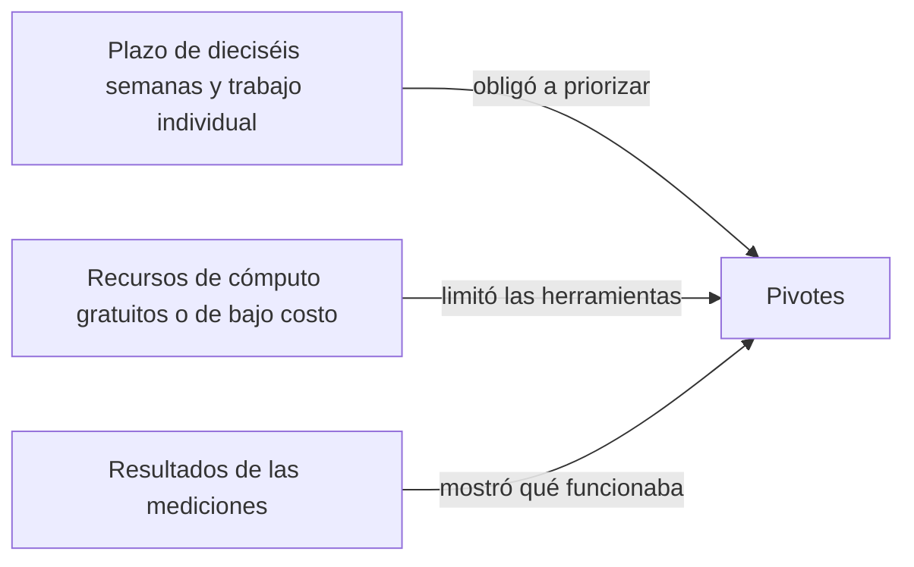

# Pivotes

Desarrollé este proyecto solo, a tiempo parcial y con un plazo de dieciséis semanas. En ese contexto tuve que cambiar varias decisiones del plan original. Algunos cambios fueron grandes, como reformular los objetivos, y otros pequeños, como sustituir una herramienta. En casi todos los casos el motivo fue el mismo: terminar algo funcional, medido y documentado dentro del plazo, en lugar de dejar a medias algo más ambicioso.

Este documento registra cada pivote, qué tenía planeado, qué hice y por qué.

## Resumen

| Planeado | Lo que hice | Motivo principal |
| --- | --- | --- |
| Onsets and Frames y variantes ViT como candidatos | Kong, hFT-Transformer y Basic Pitch | Compatibilidad con el entorno disponible |
| Ajuste fino con el corpus MAPS | Ajuste con MAESTRO degradado al azar | Tiempo |
| Google Colab como plataforma | Kaggle con dos GPU T4 | Recursos y comodidad |
| Patrón Visitor para recorrer el árbol | Despacho por tipo de nodo | Simplicidad |
| Celery con Redis para la cola de trabajos | Hilos dentro de FastAPI y trabajos en memoria | Tiempo y trabajo individual |
| Cliente nativo con APK para Android | Aplicación web progresiva | Facilidad para compartir y una sola compilación |
| Entrada de audio o de MusicXML | Solo audio, MusicXML como banco de pruebas | Enfoque en el problema |
| Veintiocho reglas | Veintiocho reglas más la agrupación de la sección IV | Resultados de las mediciones |
| Comparación celda a celda | BSA con alineación y desglose | Resultados de las mediciones |
| Tempo, compás y armadura no considerados | Parámetros de entrada | Límite del modelo acústico |
| Auditoría con TalkBack, NVDA y VoiceOver | Pruebas automáticas más recorrido con TalkBack | Sin participantes ni equipos Apple o Windows |
| Cuatro objetivos específicos | Seis objetivos específicos y un general reformulado | Claridad para medir cada parte |

## Modelos acústicos

El protocolo comparaba Onsets and Frames con variantes de Vision Transformers. La implementación original de Onsets and Frames depende de TensorFlow 1.15, que no se puede instalar con Python 3.12 ni con CUDA 12, que son las versiones de Kaggle. Construir un entorno viejo me habría costado días sin aportar al objetivo, así que la dejé como línea base bibliográfica y evalué tres familias que sí corrían: Kong, hFT-Transformer y Basic Pitch. También descarté MT3 porque usa JAX y T5X, no estima el pedal y su ventaja es transcribir varios instrumentos, algo que no necesito.

## Ajuste fino sin MAPS

Había planeado ajustar el modelo con grabaciones del corpus MAPS. Integrarlo al entorno de Kaggle dentro del plazo no fue posible, así que generé las condiciones difíciles yo mismo: tomé obras de entrenamiento de MAESTRO y les apliqué al azar compresión, ruido, reverberación y respuesta de micrófono de celular durante el entrenamiento. Con eso cumplí la meta en condiciones simuladas. Después grabé 18 obras con mi teléfono para comprobarlo fuera de la simulación, y ahí vi que no alcanza, lo que dejo como trabajo futuro.

La primera corrida del ajuste perdió 2.12 puntos en audio limpio, por encima de la tolerancia. En lugar de buscar más datos, cambié la estrategia: congelé las estadísticas de normalización por lotes y subí la proporción de audio limpio a la mitad. La segunda corrida cumplió.

## Kaggle en lugar de Colab

Colab estaba previsto como plataforma alterna, pero no la necesité. Kaggle me permitió montar MAESTRO como conjunto de datos de entrada sin descargarlo en cada sesión y me daba dos GPU T4 por sesión, con lo que repartí el lote del ajuste entre ambas. Envié y consulté todos los notebooks desde la terminal con la CLI de Kaggle, y cada uno guarda un JSON por obra para poder retomar una corrida interrumpida sin repetir la inferencia.

## Despacho por tipo en lugar de Visitor

El objetivo describía un árbol recorrido con el patrón Visitor. Implementé la misma separación entre datos y operaciones, pero con un despacho por tipo de nodo: el traductor revisa si el evento es nota, acorde o silencio y llama a la función que corresponde. Con tres tipos de nodo y una sola operación, el Visitor solo agregaba código.

## Hilos en lugar de una cola distribuida

El protocolo planteaba Celery con Redis o RQ. Para un prototipo de un solo usuario eso significaba desplegar y vigilar un servicio de mensajería y procesos de trabajo separados. Trabajando solo, preferí un grupo de hilos dentro de FastAPI con los trabajos en memoria, que cumple el requisito de procesar en segundo plano sin bloquear la API. La consecuencia es que hoy el servicio no escala horizontalmente. No lo considero un defecto del prototipo, porque el sistema está pensado para correr en una computadora local, y en [Escalabilidad y futuro](07_escalabilidad_y_futuro.md) explico cómo pasar a una cola distribuida cuando haga falta.

## Aplicación web progresiva en lugar de APK

Planeé un cliente Flutter compilado para web y como APK de Android. Al final publiqué una sola aplicación web progresiva. Un enlace es mucho más fácil de compartir que un APK, que obliga a habilitar la instalación de fuentes externas, y la misma compilación funciona en computadoras y teléfonos y se instala desde el navegador. También me ahorró mantener dos compilaciones.

## Solo audio como entrada

El protocolo admitía audio o una partitura simbólica como entrada. Decidí que el producto acepte solo audio, porque el problema que quería resolver es justamente el tramo de la grabación a la partitura. Cuando ya existe un MusicXML, hay otras herramientas que lo traducen a Braille. Conservé el lector de MusicXML como banco de pruebas: me permite probar el traductor sin GPU ni modelo, y me sirvió para medir el techo del traductor.

## Agrupación de semicorcheas

Mi subconjunto tenía 28 reglas y dejaba fuera la sección IV del Manual. Al revisar a mano por qué el BSA salía bajo, vi que las ediciones humanas agrupan las semicorcheas siempre, y que sin esa regla tres de cada cuatro semicorcheas correctas contaban como error. La implementé como extensión, con sus propias pruebas, y subió 5.5 puntos en desarrollo.

## Una métrica con alineación y desglose

El protocolo describía una comparación celda a celda. Una comparación posición por posición falla en cuanto el sistema agrega u omite una celda, porque todo lo que sigue queda corrido. Definí el BSA sobre un alineamiento de Levenshtein y, como una sola cifra mezclaba errores de distinto origen, agregué el desglose en notas por compás, alturas, ritmo y fraseo. Ese desglose fue lo que me dejó explicar por qué no se alcanzó la meta.

## Tempo, compás y armadura como parámetros

El modelo de Kong no estima tempo, compás ni armadura. Entrenar o integrar un estimador era otro proyecto, así que los pedí como parámetros. Para no depender de un tempo exacto, agregué un seguimiento del pulso que parte del tempo indicado y sigue al intérprete.

## Accesibilidad sin participantes

No conseguí participantes con discapacidad visual dentro del plazo. Seguí la metodología WCAG-EM, que permite evaluar sin usuarios combinando herramientas automáticas con una revisión experta. Medí 42 configuraciones con las pautas de Flutter, audité la página con axe-core y Lighthouse, y recorrí el flujo completo con TalkBack. No tenía un equipo Apple ni Windows para VoiceOver o NVDA, y el recorrido con Orca en computadora quedó pendiente.

Para poder automatizar el recorrido con TalkBack y registrar todo lo que dice, compilé TalkBack 16.2 desde el código fuente de Google y lo instalé en un emulador de Android 14. Las teclas que envía `adb` no llegan al lector, así que usé una imagen del sistema con permisos de administrador para escribir las teclas en el teclado del emulador, como lo haría un teclado físico, y leí del registro del sistema cada frase que TalkBack envió a la voz.

## Despliegue en Railway con hilos limitados

Desplegué la API en Railway para demostrar que el sistema funciona desde cualquier dispositivo con un navegador. En la primera prueba una grabación de 31 segundos tardó 536 segundos. El contenedor veía los 32 procesadores del servidor y PyTorch abría un hilo por cada uno, aunque solo podía usar dos. Fijé el número de hilos en dos con una variable de entorno y la misma grabación pasó a tardar 24 segundos.

## Objetivos reformulados

Pasé de cuatro a seis objetivos específicos para que cada parte se pudiera medir por separado: selección del modelo, ajuste, traductor, integración, fidelidad y cliente. El objetivo general quedó como construir el sistema y determinar qué tan cerca queda de un transcriptor humano, con la meta del 70 % en el quinto objetivo. Así el general se puede verificar con la evidencia de los seis específicos, aunque una meta no se haya alcanzado.

## Lo que aprendí de pivotear

Cada pivote me obligó a medir antes de decidir. Las decisiones que tomé por tiempo, como los hilos en memoria o la aplicación web progresiva, dejaron un sistema más simple de operar. Las que tomé por los resultados, como la agrupación de la sección IV o el desglose del BSA, son las que más aportaron a entender el problema.
