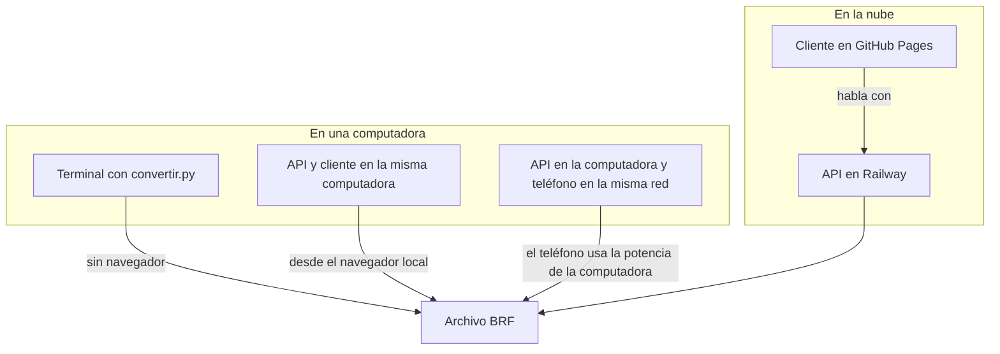
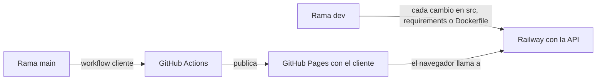

# Instalación y despliegue

Diseñé el sistema para que corra en una computadora personal, sin GPU y sin conexión a servicios externos una vez instalado. El despliegue en Railway y GitHub Pages lo hice para demostrar que también funciona desde cualquier dispositivo con un navegador, incluso uno poco potente, pero el uso principal que imagino es local: un docente, una escuela o la propia persona usuaria convirtiendo grabaciones en su equipo.

## Formas de usarlo



## Requisitos de una computadora

Estos son los valores que medí. El procesador que usé es un AMD Ryzen 7 5700X de 2020, y lo limité a 2, 4 y 8 núcleos para simular equipos más modestos.

| Recurso | Medido | Recomendación |
| --- | --- | --- |
| Procesador | Con 2 núcleos la conversión tarda 1.2 veces la duración del audio, con 8 núcleos 0.9 veces | 4 núcleos de los últimos seis o siete años; con 2 núcleos funciona, solo tarda un poco más |
| Memoria | 1.2 GB de pico durante la conversión | 4 GB de RAM en total |
| Disco | Unos 2 GB para Python, PyTorch para CPU y las dependencias, más 172 MB del modelo | 5 GB libres |
| GPU | No hace falta; con una T4 la conversión baja a 0.08 veces la duración | Opcional |
| Sistema operativo | Lo desarrollé y probé en Linux | Linux, macOS o Windows con Python 3.10 o superior |
| ffmpeg | Solo para M4A, AAC, OGG y otros formatos de teléfono | Instalarlo si se usarán grabaciones de teléfono |

No medí equipos más viejos que el mío, así que la recomendación de núcleos es una estimación a partir de la tendencia de mis mediciones. La conversión siempre termina; lo único que cambia con un equipo más lento es cuánto tarda.

## Instalación local

```bash
git clone https://github.com/G2309/amt-braille-translator.git
cd amt-braille-translator
python -m venv .venv
source .venv/bin/activate
pip install torch --index-url https://download.pytorch.org/whl/cpu
pip install -r requirements.txt
```

Instalar primero la versión de PyTorch para CPU evita descargar las bibliotecas de CUDA, que pesan varios gigabytes y no hacen falta sin GPU. El modelo ajustado se descarga solo la primera vez que se convierte un audio y se verifica con su hash.

### Desde la terminal

```bash
python convertir.py grabacion.m4a salida.brf --tempo 100 --compas 3/4 --armadura 1
```

`--armadura` recibe el número de sostenidos en positivo o de bemoles en negativo. Con `--tempo-fijo` se desactiva el seguimiento del pulso, y con `--voces` o `--ligaduras` se activan las opciones que dejé apagadas por omisión.

### Con la API y el cliente en la misma computadora

```bash
# API en el puerto 8000
uvicorn api.app:app --app-dir src --port 8000

# Cliente compilado apuntando a esa API, en otra terminal
cd cliente
flutter build web --release --dart-define=API_URL=http://localhost:8000
cd build/web && python -m http.server 8765
```

Después basta abrir `http://localhost:8765` en el navegador. Por omisión la API acepta peticiones de cualquier origen; para limitarlo se define `AMT_CORS_ORIGINS` con los orígenes permitidos separados por coma.

### Con Docker

```bash
docker build -t amt-braille-api .
docker run --rm -p 8000:8000 -e OMP_NUM_THREADS=2 amt-braille-api
```

La imagen pesa 3.1 GB y ya trae el modelo dentro. Recomiendo fijar `OMP_NUM_THREADS` con el número de núcleos que se le asignen al contenedor, por lo que explico abajo en Railway.

## Uso desde un teléfono

### Con la aplicación publicada

La forma más simple es abrir https://g2309.github.io/amt-braille-translator/ en el navegador del teléfono. La aplicación se puede instalar desde el menú del navegador y la conversión se hace en Railway. La probé con TalkBack en Android 14 de principio a fin.

### Con una computadora de la casa como servidor

Si la API corre en una computadora de la misma red, el teléfono puede usarla. Se levanta la API con `--host 0.0.0.0`, se compila el cliente con `API_URL=http://IP-de-la-computadora:8000` y se abre el cliente desde el teléfono con la IP de la computadora. Así el teléfono solo envía el audio y la computadora hace el trabajo pesado. En este caso la aplicación funciona como página web pero no se puede instalar, porque los navegadores exigen HTTPS para instalar una aplicación web progresiva fuera de `localhost`.

### Procesando en el propio teléfono

No lo probé, así que lo dejo como lo que encontré al investigar y no como algo verificado.

| Plataforma | Posibilidad | Cómo |
| --- | --- | --- |
| Android | Probablemente sí, con paciencia | Termux con una distribución Debian en proot, donde se instala Python y las ruedas oficiales de PyTorch para aarch64, que existen desde la versión 1.8. Termux nativo no sirve porque su biblioteca C no es compatible con esas ruedas. Hacen falta unos 2 GB de RAM libre y 5 GB de almacenamiento. |
| iOS | No en la práctica | iOS no permite instalar Python con PyTorch de forma normal; los emuladores de terminal disponibles emulan x86 y serían demasiado lentos. |

Aunque funcione en Android, un teléfono de gama media tiene menos núcleos rápidos que una computadora y se calienta con cargas largas, así que espero que tarde varias veces la duración del audio. Para teléfonos recomiendo cualquiera de las dos opciones anteriores. Una alternativa futura sería exportar el modelo a un formato móvil como ONNX o ExecuTorch y reescribir el pipeline sin las dependencias de escritorio.

## Despliegue en la nube que hice



### API en Railway

| Ajuste | Valor | Por qué |
| --- | --- | --- |
| Origen | Repositorio G2309/amt-braille-translator, rama `dev` | Railway construye la imagen con el `Dockerfile` |
| Recursos | 2 vCPU y 2 GB de RAM | El pico medido fue de 1.8 GB |
| Modo serverless | Activo | El contenedor duerme tras 10 minutos sin tráfico y solo cobra mientras trabaja |
| Revisión de salud | `/health` con 300 s de margen | El primer arranque carga PyTorch |
| `PORT` | 8000 | Coincide con el puerto del dominio |
| `AMT_CORS_ORIGINS` | `https://g2309.github.io,http://localhost:8765` | Solo el cliente publicado y mi compilación local de pruebas pueden llamar a la API desde un navegador |
| `OMP_NUM_THREADS` y `MKL_NUM_THREADS` | 2 | Sin este límite PyTorch abría 32 hilos para 2 vCPU y la conversión tardaba 17 veces la duración del audio |

El servidor de Railway donde corre el contenedor tiene un Intel Xeon Platinum 8581C a 2.1 GHz. Con esa configuración la conversión tarda entre 0.55 y 0.72 veces la duración del audio, más rápido que mi computadora con dos núcleos.

### Cliente en GitHub Pages

El workflow `.github/workflows/cliente.yml` corre el análisis y las pruebas de accesibilidad en cada cambio del cliente, compila la versión web con la URL de la API y publica en Pages solo desde `main`. La URL de la API sale de la variable del repositorio `API_URL`, y si no existe usa la de Railway.

## Problemas que encontré y cómo los resolví

| Síntoma | Causa | Solución |
| --- | --- | --- |
| La conversión en Railway tardaba 17 veces la duración del audio | PyTorch abría un hilo por cada procesador visible del servidor | Definir `OMP_NUM_THREADS` y `MKL_NUM_THREADS` con los núcleos asignados |
| Error de importación de `piano_transcription_inference` en el contenedor | La biblioteca usa `audioread` sin declararlo y librosa ya no lo instala | Agregar `audioread` a `requirements.txt` |
| El navegador rechaza la petición a la API | El origen del cliente no está en `AMT_CORS_ORIGINS` | Agregar el origen exacto, con protocolo y sin barra final |
| La primera conversión del día tarda unos segundos más | El contenedor estaba dormido y debe arrancar y cargar el modelo | Es el costo del modo serverless; desactivarlo si se necesita respuesta inmediata |
| Un M4A no se acepta | ffmpeg no está instalado | Instalar ffmpeg o convertir el audio a WAV antes |
