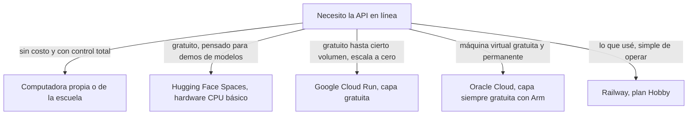

# Presupuesto

El proyecto se desarrolló sin presupuesto. Usé herramientas gratuitas para el cómputo pesado y solo pago el plan Hobby de Railway para la demostración en línea. Aquí detallo lo que costó, lo que cuesta operar y qué alternativas hay para no pagar nada.

## Lo que costó desarrollarlo

| Recurso | Uso | Costo |
| --- | --- | --- |
| Kaggle Notebooks | Benchmark, ajuste fino, latencia y transcripción de las evaluaciones con dos GPU T4 | Gratuito, con una cuota semanal de GPU |
| GitHub | Repositorio, releases con el modelo, Actions para pruebas y Pages para el cliente | Gratuito para repositorios públicos |
| MAESTRO, Open Goldberg Variations, BrailleOrch | Datos de entrenamiento y referencias Braille | Gratuitos, con licencias abiertas |
| Software | Python, PyTorch, FastAPI, Flutter, LaTeX y Nix | Libre |
| Computadora propia | Desarrollo, pruebas en CPU y redacción | Equipo que ya tenía |
| Railway, plan Hobby | API publicada para la demostración | 5 USD al mes |

El único gasto en dinero es Railway. El resto del costo fue mi tiempo: dieciséis semanas a tiempo parcial trabajando solo.

## Cuánto cuesta operar la API en Railway

El plan Hobby cuesta 5 USD al mes e incluye 5 USD de uso. Si el uso del mes no pasa de 5 USD, solo se paga la suscripción; si pasa, se paga la diferencia. Railway cobra por lo que el contenedor realmente usa, por minuto.

| Recurso | Precio de Railway |
| --- | --- |
| RAM | 10 USD por GB al mes, 0.000231 USD por GB y minuto |
| CPU | 20 USD por vCPU al mes, 0.000463 USD por vCPU y minuto |
| Tráfico de salida | 0.05 USD por GB |
| Construcción de imágenes | Gratuita |

### Costo de una conversión

Mientras convierte, el contenedor usa cerca de 2 vCPU y 1.5 GB de RAM, lo que cuesta unos 0.0013 USD por minuto de trabajo. Una grabación de cinco minutos se procesa en unos 3.1 minutos, así que cuesta cerca de 0.004 USD. Con los 5 USD incluidos alcanzaría para más de mil grabaciones de cinco minutos al mes si el contenedor solo estuviera despierto mientras trabaja.

### Costo de tenerlo despierto

El modo serverless duerme el contenedor después de 10 minutos sin tráfico, y mientras duerme no cobra. Mientras está despierto paga la memoria aunque no convierta nada. En los últimos siete días las métricas de Railway muestran 1.18 GB de memoria en promedio, porque durante las pruebas el contenedor estuvo activo casi todo el tiempo.

| Escenario | Costo estimado al mes |
| --- | --- |
| Uso ocasional, el contenedor duerme casi siempre | 5 USD, la suscripción cubre el uso |
| Contenedor despierto todo el mes con el modelo cargado | Cerca de 12 USD, unos 7 USD de uso por encima de lo incluido |
| Uso intenso, varias horas de conversión al día | Entre 12 y 20 USD |

Para controlar el gasto, Railway permite fijar un límite de uso mensual en la configuración de la cuenta, y lo recomiendo antes de compartir el enlace públicamente.

## Alternativas para hospedar sin costo o con menor costo

| Opción | Lo que ofrece | Encaje con el sistema | A considerar |
| --- | --- | --- | --- |
| Computadora local | Lo que tenga el equipo | Es el uso para el que lo diseñé | Hay que dejarla encendida si se quiere acceso desde otros equipos |
| Hugging Face Spaces, CPU básico | 2 vCPU, 16 GB de RAM y 50 GB de disco no persistente, con Docker | Muy bueno: el Dockerfile ya sirve y la RAM sobra | Duerme cuando no se usa; las condiciones del plan gratuito cambian, así que hay que revisarlas en su página de precios |
| Google Cloud Run | Capa gratuita mensual de unos 180 000 vCPU-segundos y 360 000 GiB-segundos con facturación por petición | Bueno: escala a cero y el contenedor funciona sin cambios | Con 2 vCPU y 2 GiB alcanza para unas 480 grabaciones de cinco minutos al mes; el arranque en frío carga el modelo cada vez |
| Oracle Cloud, siempre gratuito | Instancias Arm Ampere A1; se publicitaban 4 OCPU y 24 GB, y fuentes recientes indican que bajó a cerca de la mitad | Bueno: PyTorch tiene ruedas oficiales para Arm | Requiere administrar la máquina virtual y verificar los límites actuales |
| Render, plan gratuito | 512 MB de RAM | No alcanza: el modelo necesita 1.2 GB | Solo serviría para el cliente |
| GitHub Pages | Sitio estático | Ya lo uso para el cliente | No ejecuta código del servidor |

Mi recomendación es seguir usando GitHub Pages para el cliente y, si el objetivo es no pagar, mover la API a Hugging Face Spaces, que es la opción con más memoria gratuita y la que menos cambios exige. Para una escuela o una asociación, una computadora local con Docker es lo más barato y lo que mejor cuida la privacidad de las grabaciones.

## Referencias de precios

- Railway, planes y precios: https://docs.railway.com/pricing/plans
- Hugging Face Spaces: https://huggingface.co/docs/hub/spaces-overview
- Google Cloud Run, precios: https://cloud.google.com/run/pricing
- Oracle Cloud Always Free: https://www.oracle.com/cloud/free/

Los precios y las capas gratuitas cambian con frecuencia. Los de Railway los tomé de su documentación oficial; los de las demás plataformas conviene verificarlos antes de decidir.
