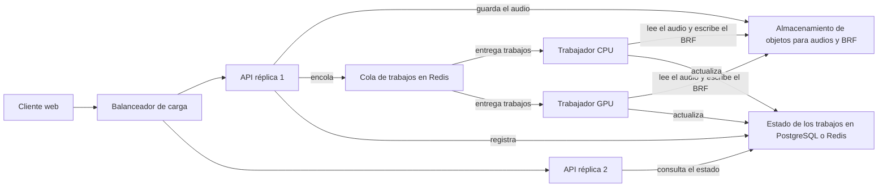
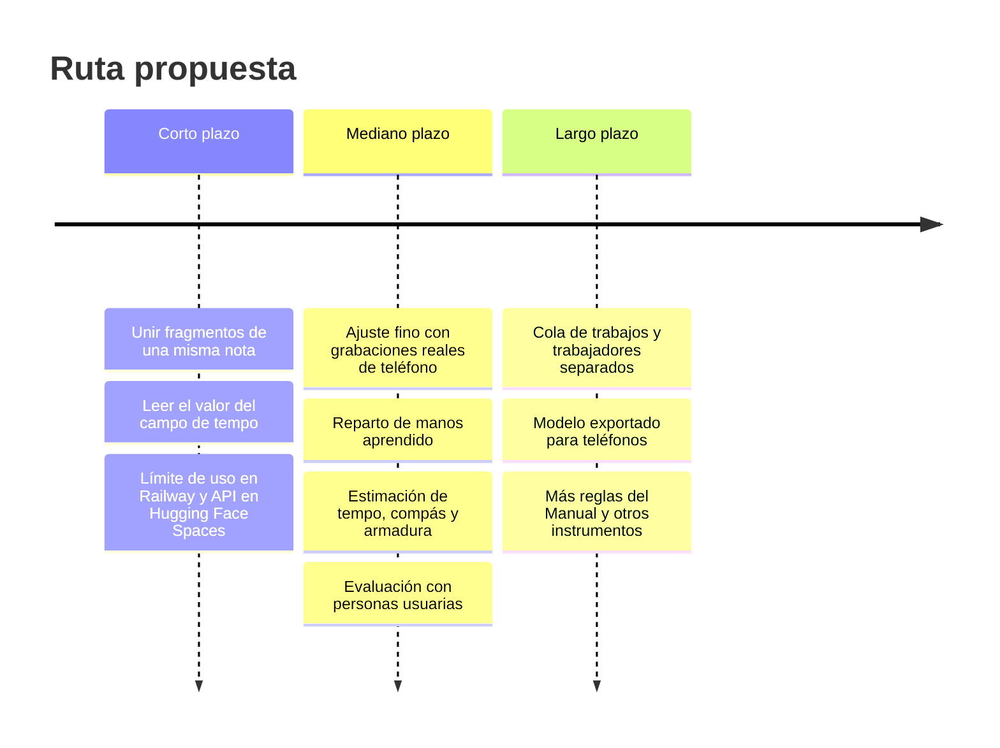

# Escalabilidad y futuro

## Hasta dónde escala hoy

Diseñé el sistema como un prototipo para una persona o una escuela, que corre en una computadora o en un solo contenedor. Esa decisión la tomé para terminar en el plazo trabajando solo, y la explico en [Pivotes](04_pivotes.md). El sistema escala bien en unas dimensiones y no en otras.

| Dimensión | Estado | Evidencia |
| --- | --- | --- |
| Vertical, más núcleos por equipo | Sí | El cociente de tiempo baja de 1.21 con 2 núcleos a 0.89 con 8, y a 0.08 con una GPU T4 |
| Escalar a cero | Sí | En Railway el contenedor duerme sin tráfico y despierta en unos 4 segundos |
| Cliente | Sí | Es un sitio estático servido por la red de entrega de GitHub |
| Duración del audio | Sí, lineal | El cociente se mantiene casi constante entre 30 y 300 segundos |
| Horizontal, varias réplicas de la API | No | Los trabajos y los BRF viven en la memoria y el disco temporal de un proceso |
| Usuarios simultáneos | Limitado | Un solo hilo de trabajo, los demás trabajos esperan en cola |

El pipeline en sí no guarda estado entre conversiones. Lo único que impide escalar horizontalmente es dónde guardo los trabajos y los archivos, no el procesamiento.

## Cómo seguir escalando

### Paso 1, más trabajos en el mismo contenedor

El cambio más pequeño es subir `max_workers` en `JobStore` y asignar más núcleos. Cada hilo de trabajo comparte el mismo modelo cargado, así que la memoria casi no crece. Hay que repartir los hilos de PyTorch entre los trabajos: con 8 vCPU y 4 trabajos simultáneos, `OMP_NUM_THREADS=2`.

### Paso 2, separar la API de los trabajadores

| Cambio | Cómo lo implementaría |
| --- | --- |
| Estado de los trabajos fuera del proceso | Reemplazar el diccionario de `JobStore` por una tabla en PostgreSQL o claves en Redis con el mismo modelo `Job` |
| Archivos fuera del proceso | Guardar audios y BRF en un almacenamiento de objetos compatible con S3, como Cloudflare R2 o MinIO, con expiración automática a las 24 horas |
| Cola de trabajos | Celery o RQ sobre Redis; la función `process` de `app.py` pasa casi sin cambios a ser la tarea del trabajador |
| Trabajadores | El mismo contenedor con otro comando de inicio; pueden ser de CPU o de GPU y escalar por largo de la cola |
| Réplicas de la API | Al no guardar nada en memoria, cualquier réplica responde cualquier consulta |

### Paso 3, optimizar el modelo

| Mejora | Efecto esperado | Cómo |
| --- | --- | --- |
| Inferencia en GPU | Cociente de 0.08 en lugar de 0.6 | Trabajadores con GPU solo cuando la cola crece |
| Exportar a ONNX Runtime | Menos memoria y algo más de velocidad en CPU, y abre la puerta a teléfonos | Exportar el modelo de Kong con `torch.onnx.export` y comparar el F1 contra el original |
| Cuantización a 8 bits | Menos memoria y más velocidad en CPU | Cuantización dinámica de PyTorch y nueva medición de F1 y BSA |
| Caché por contenido | Una grabación repetida no se vuelve a procesar | Guardar el BRF con la huella SHA-256 del audio y los parámetros |

## Lo que faltó implementar

| Pendiente | Por qué quedó fuera | Prioridad |
| --- | --- | --- |
| Robustez con grabaciones de teléfono | El ajuste se hizo con degradaciones simuladas y no alcanza con ruido doméstico real | Alta |
| Reparto de manos con cruces | El reparto por registro falla en las variaciones para dos teclados | Alta |
| Estimación de tempo, compás y armadura | El modelo acústico no los estima y no cabía otro modelo en el plazo | Media |
| Decisión automática de voces y ligaduras | Ayudan en unas obras y empeoran otras, por eso quedaron apagadas | Media |
| Ornamentos, matices, digitación y pedal en Braille | Fuera del subconjunto de 28 reglas | Media |
| Un compás distinto por mano | La Variación 26 de Goldberg lo necesita y el sistema usa uno solo | Baja |
| Prueba con un lector de pantalla de escritorio | No tenía equipos con NVDA o VoiceOver y el recorrido con Orca quedó pendiente | Media |
| Evaluación con personas ciegas | No conseguí participantes dentro del plazo | Alta |
| Lectura del valor del campo de tempo con TalkBack | Detectado en la última prueba | Baja |
| Autenticación, límite de peticiones y persistencia | El prototipo es de un solo usuario | Necesaria antes de un uso público amplio |

## Cómo mejoraría el sistema

### Calidad de la partitura

El cuello de botella está entre el audio y la partitura que arma el cuantizador, no en el traductor, que con la partitura correcta llega a 89.1 % y 78.8 % de exactitud. Por eso las mejoras con más impacto están en la etapa acústica y en el cuantizador.

1. **Unir los fragmentos de una misma nota.** En las grabaciones de teléfono el modelo parte una nota sostenida en varios ataques. Un filtro que una ataques de la misma tecla separados por menos de un umbral, elegido con la partición de desarrollo, atacaría directamente la causa medida.
2. **Ajuste fino con grabaciones reales de teléfono.** Grabar obras con partitura MIDI conocida, por ejemplo tocándolas en un piano digital que registre MIDI mientras un teléfono graba el sonido, daría pares reales para un segundo ajuste fino.
3. **Reparto de manos aprendido.** Entrenar un clasificador pequeño que decida la mano de cada nota con datos de partituras donde las manos están marcadas, en lugar de la regla de cercanía de registro.
4. **Estimar tempo, compás y armadura.** Integrar un estimador de pulso y compás y un estimador de tonalidad para que la persona usuaria no tenga que dar esos datos.
5. **Voces por tipo de obra.** Activar las voces solo cuando la textura sea contrapuntística, con un detector sencillo de polifonía sostenida.

### Accesibilidad

1. Leer el valor del campo de tempo, revisando las propiedades semánticas del campo de texto en Flutter.
2. Probar con NVDA en Windows, VoiceOver en macOS e iOS y Orca en Linux.
3. Hacer una evaluación con personas ciegas que estudien piano, que es lo que más falta para validar el sistema.
4. Agregar una vista previa del Braille navegable con línea Braille, celda por celda.

## Futuro del proyecto

Veo el proyecto como una herramienta de apoyo para docentes y estudiantes, no como un reemplazo del transcriptor humano. Con la exactitud actual, el BRF generado es un primer borrador que un docente puede corregir mucho más rápido que transcribir desde cero, y que un estudiante puede usar para conocer una obra que no existe en Braille. Si el código se mantiene abierto, la métrica BSA y las referencias que reuní pueden servir a otros para medir sus propias mejoras.
