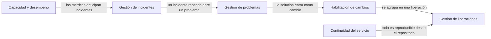
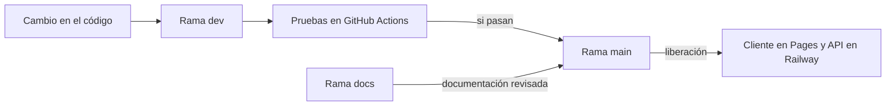

# Operación, seguridad y KPIs

En este documento miro el sistema como lo haría un administrador de sistemas: qué servicio entrega, cómo se mide, cómo se cambia y se libera, qué riesgos de seguridad tiene y qué haría falta antes de abrirlo a muchos usuarios. Uso como marco las prácticas de ITIL 4 y los principios de DevOps.

## El servicio

| Elemento | Definición |
| --- | --- |
| Servicio | Conversión de grabaciones de piano a partituras de musicografía Braille |
| Personas usuarias | Estudiantes de piano con discapacidad visual, sus docentes y transcriptores que quieren un borrador |
| Canales | Aplicación web progresiva, API REST y terminal |
| Componentes | Cliente en GitHub Pages, API en Railway, modelo publicado en un release de GitHub |
| Horario | Disponible todo el día, sin garantía, porque es un prototipo |
| Soporte | Issues del repositorio en GitHub |

## KPIs y métricas

Separé las métricas en las que miden la calidad del producto, las que miden la operación del servicio y las que miden el proceso de desarrollo.

| Grupo | KPI | Meta o valor de referencia | Valor actual | Dónde se mide |
| --- | --- | --- | --- | --- |
| Calidad | BSA medio en la partición de prueba de Goldberg | 70 % | 33.2 % | `scripts/desglose_bsa.py` |
| Calidad | BSA con la partitura como entrada | 70 % | 78.8 % | `scripts/techo_traductor.py` |
| Calidad | F1 a nivel de nota del modelo | 75 % | 83.74 % | Notebook de benchmark |
| Desempeño | Cociente entre tiempo de proceso y duración del audio | 1.5 o menos | Máximo de 0.72 en Railway | Campo `latency_norm` de cada trabajo |
| Desempeño | Tiempo de la primera respuesta con el contenedor dormido | 10 s o menos | 4.3 s | `scripts/latencia_railway.py` |
| Confiabilidad | Trabajos terminados sin error | 99 % | 100 % en las pruebas | Campo `status` de cada trabajo |
| Confiabilidad | BRF que pasan la validación | 100 % | 100 % | Campo `brf_valid` de cada trabajo |
| Disponibilidad | Respuestas correctas de `/health` | 99 % al mes | Sin monitor externo todavía | Monitor externo propuesto |
| Capacidad | Memoria máxima frente al límite del contenedor | Por debajo del 80 % | 1.83 de 2 GB, 92 % | Métricas de Railway |
| Costo | Costo por grabación de cinco minutos | Menos de 0.01 USD | Cerca de 0.004 USD | Cálculo con precios de Railway |
| Accesibilidad | Configuraciones que pasan las pautas de Flutter | 100 % | 42 de 42 | `cliente/test/accesibilidad_test.dart` |
| Accesibilidad | Violaciones de WCAG A y AA | 0 | 0 | `cliente/auditoria/auditar.mjs` |
| Accesibilidad | Elementos verificados con lector de pantalla | 100 % | 10 de 10 con TalkBack | `cliente/auditoria/talkback.sh` |
| Desarrollo | Pruebas que pasan en integración continua | 100 % | 249 pruebas | GitHub Actions |

### Seguimiento

Cada trabajo de la API ya guarda la duración del audio, la latencia, el cociente, si está dentro del alcance y si el BRF es válido. Es la base para un tablero. Lo que haría para el seguimiento continuo:

1. Un monitor externo gratuito, como UptimeRobot o Better Stack, que consulte `/health` cada cinco minutos y avise por correo.
2. Registros en JSON con el identificador del trabajo, el cociente y el resultado, para filtrarlos en la vista de registros de Railway.
3. Un endpoint de métricas con el formato de Prometheus si el servicio crece, con conteo de trabajos por estado y percentiles del cociente.
4. Repetir los scripts de `results/` en cada liberación, para detectar si un cambio baja el BSA o sube la latencia.

## Prácticas de ITIL aplicadas

### Gestión de incidentes

El mejor ejemplo lo tuve al publicar la API. La primera conversión de una grabación de 31 segundos tardó 536 segundos.

| Fase | Lo que hice |
| --- | --- |
| Detección | La prueba de punta a punta mostró un cociente de 17.06 contra el límite de 1.5 |
| Diagnóstico | Los registros mostraban que la transcripción avanzaba muy lento. Leí el procesador con un servicio temporal: el contenedor veía 32 procesadores con una cuota de 2 vCPU |
| Causa | PyTorch abría un hilo por cada procesador visible y los hilos se peleaban por dos núcleos |
| Resolución | Fijé `OMP_NUM_THREADS` y `MKL_NUM_THREADS` en 2 |
| Verificación | La misma grabación tardó 24.3 segundos, un cociente de 0.77, y los cuatro cortes de prueba quedaron entre 0.55 y 0.72 |
| Registro | Quedó documentado en la tesis, en `results/README.md` y en este manual |

### Gestión de problemas

El primer despliegue falló con un error de importación de `piano_transcription_inference`. La causa raíz era que esa biblioteca usa `audioread` sin declararlo como dependencia, y las versiones nuevas de librosa ya no lo instalan. Lo resolví declarando `audioread` en `requirements.txt` y cambié el mensaje de error para que muestre la causa original, de modo que un problema parecido se diagnostique en segundos.

### Habilitación de cambios y gestión de liberaciones

El código se integra en `dev`, la documentación en `docs` y las versiones liberadas en `main`. Cada cambio corre las pruebas antes de pasar a `main`. Hoy Railway construye la API desde `dev`, y recomiendo cambiarlo a `main` para que la API publicada sea siempre una versión liberada, igual que el cliente.

### Capacidad y desempeño

La memoria llegó a 1.83 GB de un límite de 2 GB, por encima del 80 % que recomendaría como umbral. Antes de permitir dos trabajos simultáneos subiría el límite a 3 GB. Para la CPU, las mediciones de latencia por número de núcleos sirven como modelo de capacidad: con 2 vCPU un trabajo de cinco minutos tarda unos tres minutos, así que un contenedor atiende unas 20 grabaciones de cinco minutos por hora.

### Continuidad del servicio

Todo lo necesario para reconstruir el servicio está versionado: el código y los workflows en el repositorio, el modelo en un release de GitHub con su hash, los experimentos en notebooks publicados en Kaggle y la configuración de Railway descrita en [Instalación y despliegue](05_instalacion_y_despliegue.md). Si Railway dejara de estar disponible, la misma imagen corre en Hugging Face Spaces, en Google Cloud Run o en una computadora local.

## Principios de DevOps aplicados

| Principio | Cómo lo apliqué | Qué falta |
| --- | --- | --- |
| Integración continua | Workflow de pruebas en Python 3.10, 3.12 y 3.13 y workflow del cliente en cada push | Agregar análisis de vulnerabilidades de dependencias |
| Entrega continua | Pages publica el cliente desde `main` y Railway construye la API al cambiar el código | Mover el origen de Railway a `main` |
| Infraestructura como código | `Dockerfile`, workflows y variables documentadas | Un archivo `railway.toml` con los recursos, la revisión de salud y el modo serverless |
| Observabilidad | Métricas y registros de Railway y campos de latencia por trabajo | Monitor externo y registros estructurados |
| Reproducibilidad | Semilla fija en todos los muestreos, notebooks con su versión de Kaggle y scripts que regeneran cada CSV | Fijar versiones exactas de las dependencias con un archivo de bloqueo |

Si el servicio tuviera usuarios, mediría las cuatro métricas DORA: frecuencia de despliegue, tiempo desde el cambio hasta producción, tasa de fallos de los cambios y tiempo de recuperación. Hoy el tiempo de recuperación del incidente de latencia fue de una tarde.

## Seguridad

### Controles que ya tiene

| Control | Cómo funciona |
| --- | --- |
| HTTPS | GitHub Pages y Railway sirven todo con TLS |
| CORS restringido | La API publicada solo acepta peticiones del navegador desde el origen del cliente |
| Lista de formatos permitidos | La API rechaza con 415 cualquier extensión fuera de MP3, WAV, FLAC y los formatos de teléfono |
| Límite de tamaño | La subida se corta a los 100 MB y se borra lo recibido |
| Identificadores no adivinables | Cada trabajo usa un UUID aleatorio de 128 bits |
| Sin datos personales | No hay cuentas ni base de datos; el audio y el BRF solo existen en una carpeta temporal |
| Limpieza al apagar | La carpeta temporal se borra cuando la API se detiene |
| Modelo verificado | El checkpoint se descarga del release y se compara con su hash SHA-256 antes de usarlo |
| Sin secretos en el código | No hay claves; la configuración va en variables de entorno |

### Riesgos y cómo los atendería

| Riesgo | Impacto | Mitigación propuesta |
| --- | --- | --- |
| No hay autenticación ni límite de peticiones | Cualquiera puede enviar audios y generar costo de cómputo | Límite por IP con un middleware como slowapi, una clave de API para usos fuera del cliente y un límite de gasto en Railway |
| ffmpeg procesa archivos que sube cualquier persona | Un archivo malicioso podría explotar una vulnerabilidad del decodificador | Mantener la imagen actualizada, limitar el tiempo de ffmpeg y correrlo con un usuario sin privilegios |
| El contenedor corre como root | Una vulnerabilidad daría control total del contenedor | Agregar un usuario sin privilegios en el `Dockerfile` |
| Los archivos se borran solo al apagar | En un contenedor que no duerme se acumulan grabaciones | Borrar audio y BRF una hora después de terminar el trabajo |
| Dependencias con vulnerabilidades conocidas | Riesgo heredado de PyTorch, FastAPI o librosa | Dependabot y `pip-audit` en GitHub Actions |
| Grabaciones de terceros en un servidor externo | Privacidad de quien graba | Recomendar el uso local cuando las grabaciones sean sensibles y no guardar nada más allá del trabajo |
| Parámetros numéricos sin rango | Un tempo o un compás absurdo produce un error del trabajo | Validar rangos en la API antes de encolar |

Ninguno de estos riesgos es crítico para un prototipo de demostración de un solo usuario, pero los tres primeros los resolvería antes de compartir el enlace públicamente.
