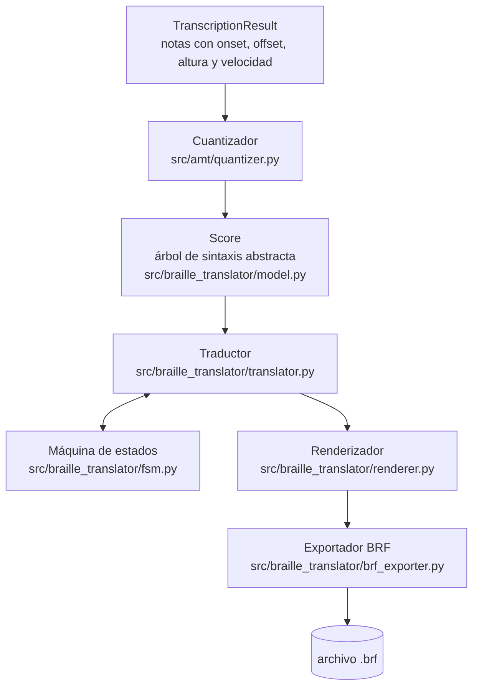

# Módulo determinista de traducción — Objetivo específico 3

Este documento describe la etapa determinista del sistema: el bloque que toma la salida del módulo de transcripción (o de un archivo MusicXML, en el banco de pruebas) y produce un archivo BRF válido, aplicando el subconjunto de veintiocho reglas descrito en `braille_rules_subset.md`.

La etapa tiene seis componentes que se ejecutan en orden fijo. Cada uno vive en su propio archivo y tiene una sola responsabilidad.

## Diagrama

La máquina de estados no es una etapa más en la fila: el traductor la consulta compás a compás mientras recorre el árbol, por eso el diagrama la dibuja como caja aparte y no en la línea principal.

## 1. Cuantizador

Archivo: `src/amt/quantizer.py`.

Recibe un `TranscriptionResult` (notas con tiempos en segundos) y produce un `Score`. Hace tres cosas: separa las notas entre mano derecha e izquierda según una altura de corte, redondea los tiempos continuos a una grilla de semicorchea (`TICKS_PER_QUARTER = 4`), y agrupa en acordes las notas que comparten el mismo instante de ataque. Una nota que no cabe entera en un compás se parte en varias unidas por ligadura de prolongación, sin perder duración total.

Antes de cuantizar, `src/amt/postprocess.py` limpia las notas con dos heurísticas ligeras que el pipeline activa por omisión. La primera quita armónicos de octava, notas una octava, una duodécima o dos octavas por encima de otra que empiezan casi a la vez y no suenan más fuerte. La segunda reparte las manos por continuidad de registro en lugar de cortar en el Do central: acorde por acorde, divide las notas por el punto que deja a cada mano más cerca de su registro reciente, con una penalización cuando una mano abarcaría más de una décima. Después, `src/amt/beats.py` sigue el pulso de la intérprete. Una programación dinámica sobre los ataques busca la secuencia de pulsos que mejor cae en ellos sin cambiar de tempo de golpe, a partir del tempo indicado, y cada nota se lleva al tiempo de partitura interpolando entre pulsos antes de cuantizar. Así las barras no se desplazan con el rubato. Una segunda programación dinámica sobre la posición de cada pulso dentro del compás quita los pulsos que el seguimiento agrega en los ritardandos. El cuantizador también tiene un legato de 0.75: el silencio que deja una nota tocada separada se escribe como parte de la nota si no pasa de tres cuartos del intervalo hasta el siguiente ataque. Como opción, apagada por omisión, separa en voces con in-accord los compases donde más de la mitad de los ataques entran mientras otra nota de la misma mano sigue sonando, empezando por la voz aguda en la derecha y por la grave en la izquierda según la regla 5-12.

## 2. Árbol de sintaxis abstracta (AST)

Archivo: `src/braille_translator/model.py`.

Son las clases de datos que representan la partitura ya cuantizada: `Score`, `Hand`, `Measure`, los tres tipos de evento (`Note`, `Chord`, `Rest`) y `MultiRest` para los compases de espera. Un `Chord` sabe distinguir su nota principal de las secundarias según la mano (`principal`, `secondary`), que es justo lo que el traductor necesita para decidir qué nota lleva el signo de la figura y cuáles se escriben como intervalo.

Este árbol existe porque el formato compás sobre compás (sección 5) necesita conocer de antemano cuánto mide cada compás de ambas manos para alinearlas verticalmente. Esa alineación no se puede resolver escribiendo celda por celda a medida que llegan los datos; hace falta tener la obra completa en memoria antes de emitir el primer carácter.

El diagrama de clases del árbol está en [Arquitectura](02_arquitectura.md#el-árbol-de-la-partitura).

## 3. Máquina de estados

Archivo: `src/braille_translator/fsm.py`.

Lleva dos contextos que el Braille musical necesita arrastrar entre notas:

- `OctaveState` decide si una nota necesita signo de octava, comparando su distancia con la nota anterior (unísono, segunda y tercera nunca llevan signo; sexta o mayor siempre lo lleva; cuarta y quinta dependen de si hubo cambio real de octava).
- `AccidentalState` lleva las alteraciones vigentes dentro del compás, inicializadas con la armadura de la clave y reiniciadas al empezar cada compás nuevo.

Cada mano tiene su propia instancia de ambos estados, porque la octava y las alteraciones de una mano no dependen de lo que esté pasando en la otra.

## 4. Traductor

Archivo: `src/braille_translator/translator.py`.

`HandTranslator` recorre los compases de una mano, consulta la máquina de estados para cada nota y arma la cadena de celdas Braille Unicode del compás. Dentro de un acorde, la nota principal se escribe como nota completa y las secundarias como intervalos respecto a ella; el caso del unísono (dos notas con la misma letra y octava pero distinta alteración) se resuelve como si fuera un intervalo de octava, un error de los acordes cromáticos que las pruebas detectaron y corregí.

El traductor también decide los signos de valor de la regla 1-3 cuando una figura es ambigua dentro del compás, y aplica la agrupación de semicorcheas y fusas de la sección IV del Manual (reglas 4-2 a 4-7): dentro de cada pulso, la primera nota lleva su figura y las demás se escriben con forma de corchea. Esta agrupación no estaba en el subconjunto de 28 reglas; la agregué porque las ediciones de referencia la usan siempre, y está activa por omisión en el pipeline.

Cuando el compás tiene cópula (varias voces simultáneas en la misma mano), cada voz se traduce por separado y se unen con el signo de cópula; las alteraciones no cruzan de una voz a otra.

## 5. Renderizador

Archivo: `src/braille_translator/renderer.py`.

Toma los compases ya traducidos de ambas manos y arma el formato compás sobre compás: agrupa los compases en líneas paralelas, alinea verticalmente el inicio de cada compás rellenando con una línea guía de punto 3 el que quede más corto, y antepone el signo de mano correspondiente a cada línea.

## 6. Exportador BRF

Archivo: `src/braille_translator/brf_exporter.py`.

Convierte el texto Braille Unicode a Braille ASCII (formato BRF), corta las líneas a cuarenta celdas sin partir un compás a la mitad, sangra las líneas de continuación, e inserta un salto de página cada veinticinco líneas. También expone `validate_brf`, que revisa un archivo ya escrito y reporta líneas demasiado largas o caracteres fuera del alfabeto Braille ASCII.

## Trazabilidad con las pruebas

| Componente | Archivo de prueba |
| --- | --- |
| Cuantizador | `tests/test_amt.py` (clase `TestQuantize`) |
| Limpieza, reparto de manos y voces | `tests/test_postprocess.py` |
| Seguimiento del pulso | `tests/test_beats.py` |
| Traductor, máquina de estados, renderizador, exportador | `tests/test_translator.py` |

El AST no tiene un archivo de prueba propio: sus clases se ejercitan indirectamente a través de las pruebas del traductor, porque su única función es servir de dato de entrada al resto del pipeline.
